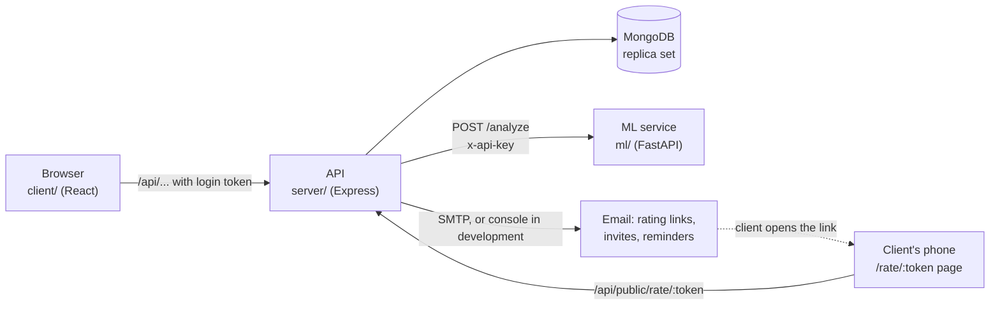
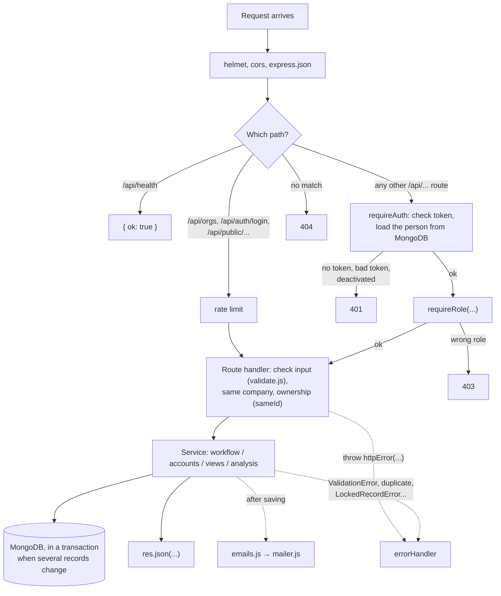
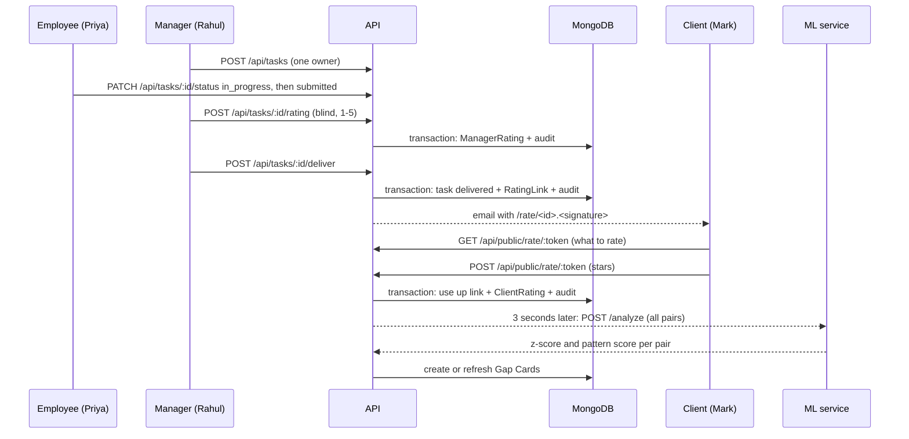

# FairView: How the Code Runs

This file follows the code from the moment you type a command to the moment a reply comes back: where each part starts, what runs in what order, and which function calls which. The reasons behind each choice are in [Decision.md](Decision.md).

FairView has three parts that run separately:

| Part | Folder | Language | Job |
| --- | --- | --- | --- |
| Web app | `client/` | React | The screens for HR, managers, employees, and the client's rating page |
| API | `server/` | Node.js, Express | All rules, the database, emails |
| ML service | `ml/` | Python, FastAPI | The gap analysis (z-score and Isolation Forest) |

When a route, page, middleware or file is added or moved, update this file in the same commit.

**Reading the code for the first time?** Go in this order: `server/src/index.js` → `server/src/app.js` → `server/src/middleware/auth.js` → `server/src/services/workflow.js` → `server/src/models/lockRecord.js` → `ml/app/analysis.py` → `client/src/App.jsx`. These explain most of FairView.

## 1. The big picture



In one line: **people use the React app, the app calls the API, the API checks every rule and saves to MongoDB, emails the client a one-time link when work is delivered, and asks the ML service to compare the two ratings once the client has rated.**

## 2. Entry points

| Command (run in the folder shown) | First file that runs | What happens |
| --- | --- | --- |
| `server/`: `npm start` or `npm run dev` | `src/index.js` | Starts the API on port 5000 (`dev` restarts on every save) |
| `server/`: `npm run demo` | `src/scripts/demo.js` | Starts a temporary in-memory MongoDB, creates the demo company and starts the API. No Atlas needed; all data is deleted on stop (section 13) |
| `server/`: `npm run seed` | `src/scripts/seed.js` | Creates the demo company, then exits (section 13) |
| `server/`: `npm run reminders` | `src/scripts/reminders.js` | Sends one reminder per unused rating link, then exits (section 13) |
| `server/`: `npm test` | Jest → `tests/setup/globalSetup.js` | Starts an in-memory MongoDB, runs the tests (section 14) |
| `ml/`: `uvicorn app.main:app --port 8000` | `app/main.py` | Starts the ML service on port 8000 |
| `ml/`: `python -m pytest` | `tests/*.py` | ML tests |
| `ml/`: `python -m sim.evaluate` | `sim/evaluate.py` | Measures the detector on made-up companies, writes `reports/evaluation.md` |
| `client/`: `npm run dev` | `index.html` → `src/main.jsx` | Starts the web app on port 5173; `/api` calls go to port 5000 |
| `client/`: `npm run build` | `vite.config.js` | Builds the web app into `client/dist/` |

`server/requests.http` is not an entry point. It is a list of requests you send to a running API.

## 3. Starting the API, step by step

1. Node runs `server/src/index.js`.
2. `require('./config/env')` runs `config/env.js`: `dotenv` copies `.env` into `process.env`, and the file works out every setting (port, token lifetime, allowed websites, `APP_URL`, email, ML service address, link lifetimes and the analysis rules) and exports them with `required()`.
3. `require('./config/db')` only defines `connectDB()`.
4. `require('./app')` runs `src/app.js` top to bottom (section 4). When it finishes, every route, service, model and helper file is loaded.
5. `start()` runs:
   1. `required('JWT_SECRET')` stops with `Missing JWT_SECRET in .env` if it is empty.
   2. `connectDB(uri)` calls `mongoose.connect(uri, { serverSelectionTimeoutMS: 5000 })`, then `assertReplicaSet()` sends MongoDB a `hello` command. If the answer has no replica set name, it disconnects and stops with a message explaining why (transactions need a replica set).
   3. It warns if `SMTP_URL` is empty (emails go to the console) or `ML_URL` is empty (no gap analysis).
   4. `app.listen(port)` prints `FairView API running on http://localhost:5000`.
6. If any step throws, `.catch()` prints `Could not start the server: <reason>` and exits with code 1.

Node loads each file only once and then reuses it, so `.env` is read once even though several files require `config/env.js`.

## 4. What `app.js` sets up, in order

Express checks these from top to bottom for every request.

| # | Code in `app.js` | What it does |
| --- | --- | --- |
| 1 | `app.set('trust proxy', ...)` | Only if `TRUST_PROXY` is set: reads the real client address behind a hosting proxy |
| 2 | `helmet()` | Adds standard security headers |
| 3 | `cors({ origin: corsOrigins })` | Lets only the listed websites call the API from a browser |
| 4 | `express.json({ limit: '100kb' })` | Turns a JSON body into `req.body` |
| 5 | `GET /api/health` | `{ "ok": true }`, no login |
| 6 | `/api/orgs` → `routes/orgs.js` | Company sign-up (public, rate limited) |
| 7 | `/api/auth` → `routes/auth.js` | Login (public, rate limited) and "who am I" |
| 8 | `/api/public` → `routes/public.js` | Client rating link and invite link pages (no login, rate limited) |
| 9 | `/api/users` → `routes/users.js` | People, invites, CSV import |
| 10 | `/api/projects` → `routes/projects.js` | Projects and client contacts |
| 11 | `/api/tasks` → `routes/tasks.js` | Work, status changes, manager rating, delivery, resend link |
| 12 | `/api/ratings` → `routes/ratings.js` | Only refuses edits and deletes (the lock) |
| 13 | `/api/gap-cards` → `routes/gapCards.js` | Gap Cards and "run analysis now" (HR only) |
| 14 | `/api/insights` → `routes/insights.js` | Employee record, manager team view, HR overview, audit log |
| 15 | `/api/dev` → `routes/dev.js` | Only if `DEV_OUTBOX=true` and not production: the email outbox |
| 16 | 404 handler | `Not found.` |
| 17 | `errorHandler` | Every error from above ends here (section 10) |

Loading a model file builds its schema. For the three locked models (`ClientRating`, `ManagerRating`, `AuditLog`), `schema.plugin(lockRecord)` attaches the lock hooks at this moment.

## 5. Which file uses which (server)

| Layer | Files | Uses | Used by |
| --- | --- | --- | --- |
| Config | `config/env.js`, `config/db.js` | dotenv, mongoose | almost everything |
| Middleware | `auth.js` (`requireAuth`, `requireRole`), `rateLimits.js`, `blockEdits.js`, `errorHandler.js` | jsonwebtoken, `User`, express-rate-limit, `utils/audit` | route files, `app.js` |
| Routes | `routes/*.js` | middleware, services, models, `utils/*` | `app.js` |
| Services | `workflow.js` | models, `links`, `emails`, `analysis`, `utils/audit` | `routes/tasks.js`, `routes/public.js` |
| | `accounts.js` | models, bcryptjs, jsonwebtoken, csv-parse, `links`, `emails` | `routes/orgs.js`, `auth.js`, `users.js`, `public.js` |
| | `analysis.js` | `ClientRating`, `ManagerRating`, `GapCard`, `Organization`, `fetch` | `workflow.js`, `routes/gapCards.js`, `seed.js` |
| | `views.js` | models | `routes/tasks.js`, `projects.js`, `insights.js`, `gapCards.js` |
| | `emails.js` → `mailer.js` | nodemailer (only with `SMTP_URL`), `links` | `workflow.js`, `accounts.js`, `reminders.js` |
| | `links.js` | Node `crypto`, `config/env` | `emails.js`, `workflow.js`, `accounts.js`, `seed.js` |
| Models | `Organization`, `User`, `Project`, `Task`, `ManagerRating`, `ClientRating`, `RatingLink`, `GapCard`, `AuditLog`, plugin `lockRecord` | mongoose | services, routes, scripts |
| Utils | `audit.js`, `httpError.js`, `sameId.js`, `validate.js` | `AuditLog` (audit only) | routes, services, middleware |

## 6. The path of every request



- **`requireAuth`** reads `Authorization: Bearer <token>`, runs `jwt.verify(token, JWT_SECRET)`, then `User.findById(payload.sub)`. If the person is missing or deactivated: 401. Otherwise it sets `req.user = { id, org, role, name }`. Loading the person every time means a deactivation or role change works on the very next request.
- **Company filter:** every handler puts `org: req.user.org` into its queries. A record from another company is simply not found (404).
- **`requireRole('hr')`** answers 403 for any other role. The routers for users, projects, tasks, ratings and insights start with `router.use(requireAuth)`; `gapCards.js` starts with `router.use(requireAuth, requireRole('hr'))`.
- **Handlers are `async`.** A thrown error goes straight to `errorHandler` (Express 5 does this), so routes have no `try/catch`.

## 7. The core loop



In the web app, the manager's "Rate and send to client" button makes the rating call and then the delivery call.

## 8. Route by route: which function calls which

Left: what runs. Right: the reply if that step fails.

### Accounts

```
POST /api/orgs  (public)                         routes/orgs.js
→ validate: orgName, name, email, password       400
→ accounts.signupOrganization()
    bcrypt.hash(password, 10)
    transaction: User.exists(email)?             409 email already used
                 Organization.create, User.create (role hr), audit 'org.create'
→ 201 { token, user }

POST /api/auth/login  (public)                   routes/auth.js
→ email and password are text?                   400
→ accounts.login()
    User.findOne({ email }).select('+passwordHash')
    bcrypt.compare(password, hash or DUMMY_HASH) (always runs, same timing)
    no user, no password yet, wrong password     401 Wrong email or password.
    deactivated                                  403
    jwt.sign({ sub }, JWT_SECRET, { expiresIn })
→ 200 { token, user }

GET  /api/auth/me                                requireAuth → User + Organization → 200

POST /api/users  (HR)                            routes/users.js
→ validate name, email, role                     400
→ accounts.inviteUser(): User.create with inviteNonce + expiry (7 days)
                                                 409 email already used
    audit 'user.invite', then emails.sendInvite() → links.inviteUrl(id, nonce)
→ 201 { user, emailSent }

POST /api/users/import  (HR, text/csv)           → accounts.importUsers(): csv-parse, then
                                                   inviteUser() per row; errors kept per line
→ 201 { created, errors }
POST /api/users/:id/resend-invite  (HR)          → accounts.resendInvite(): new nonce (old link dies), email
GET  /api/users?role=                            HR: emails, active, joined. Others: names and roles
PATCH /api/users/:id  (HR) { active?, role? }    not yourself → 409; audit 'user.update'

GET  /api/public/invite/:token                   → accounts.describeInvite() → findInvitedUser():
                                                   links.matches('invite', token, user.inviteNonce)
POST /api/public/invite/:token { password }      → accounts.acceptInvite(): set hash, remove nonce
                                                   (conditional update: works once) → { token, user }
```

### Projects and work

```
POST /api/projects  (manager, or HR with managerId)
→ checkClient(): name, email; email of a FairView user?   400
→ Project.create, audit 'project.create'                  → 201
GET  /api/projects                     HR all · manager his own · employee projects with her work
                                       (+ task counts; employees never see the client email)
GET  /api/projects/:id                 project + its tasks via views.withRatings()   403 / 404
PATCH /api/projects/:id/client  (HR)   checkClient(), audit with old -> new email
PATCH /api/projects/:id/status         'active' | 'closed', project's manager or HR

POST /api/tasks  (manager)                       routes/tasks.js
→ Project in my company? mine? active?           404 / 403 / 409
→ User is an active employee in my company?      400
→ Task.create, audit 'task.create'               → 201

GET  /api/tasks?status=&projectId=     employee her work · manager his · HR all
                                       → views.withRatings(tasks, req.user)
GET  /api/tasks/:id                    HR, its manager or its employee     403 / 404

PATCH /api/tasks/:id/status { status, submission }
  employee: assigned → in_progress → submitted (submission required)     409 / 400
  manager:  submitted → in_progress, only while ManagerRating doesn't exist  409
→ task.save(), audit 'task.<status>' or 'task.rework'

POST /api/tasks/:id/rating  (manager) { score, comment }
→ validate.stars(score)                                   400
→ workflow.rateAsManager(): transaction
    loadOwnTask() (my company, my task)                   404 / 403
    status is 'submitted'?                                409
    ManagerRating.exists?                                 409 already rated
    ManagerRating.create, audit 'rating.manager.create'   → 201

POST /api/tasks/:id/deliver  (manager)
→ workflow.deliverTask(): transaction
    loadOwnTask(), status 'submitted'?                    409
    ManagerRating.exists?                                 409 Rate this work before delivering it.
    RatingLink.create (client from the project, expires in 14 days)
    task: status 'delivered', deliveredAt, ratingWindowEndsAt
    audit 'task.deliver'
  after saving: emails.sendRatingLink(link, 'request') → links.ratingUrl(linkId) → mailer.sendMail()
→ 200 { task, emailSent }

POST /api/tasks/:id/resend-link  (task's manager or HR)
→ workflow.resendRatingLink(): transaction
    delivered? client not rated yet? fewer than 3 links?  409
    revoke unused links, RatingLink.create, new ratingWindowEndsAt, audit
  after saving: email the new link
```

### The client's rating (no login)

```
GET  /api/public/rate/:token
→ workflow.describeRatingLink()
    links.idFromToken() + links.matches('rate', token)    404 not valid
    RatingLink, Organization, Project, Task, employee name
→ 200 { state: ready | used | replaced | expired, taskTitle, employeeName, ... }
  (never the manager's score)

POST /api/public/rate/:token { score, comment }
→ validate.stars(score), validate.text(comment)           400 (link NOT used up)
→ workflow.submitClientRating(): transaction
    token genuine?                                         404
    used? replaced? expired?                               409 / 410 / 410
    RatingLink.updateOne({ _id, usedAt: null, revokedAt: null }, { usedAt: now })
      changed 0 records → someone was faster              409
    ClientRating.create (manager and employee copied from the task)
    audit 'rating.client.create' by 'client <email>'
  after saving: analysis.schedule(org)
→ 201 { ok, score }
```

### The lock

```
PUT | PATCH | DELETE  /api/ratings/client/:id  or  /api/ratings/manager/:id
→ requireAuth                                    401 if not logged in (nothing logged)
→ blockEdits('ClientRating' | 'ManagerRating'): audit outcome 'blocked'
→ 403 ... records are locked and cannot be changed or deleted.
```

### Insights and Gap Cards

```
GET /api/insights/record   (employee)  views.employeeRecord(): her delivered work + withRatings + averages
GET /api/insights/team     (manager)   views.teamView(): ratedPairs({ manager: me }) → summarise() per person
GET /api/insights/overview (HR)        views.overview(): people by role, last 90 days delivered vs
                                       client-rated, open/reviewed cards, analysis status, per manager
GET /api/insights/audit    (HR)        AuditLog newest first, ?outcome=blocked, ?entity=, ?before=

GET  /api/gap-cards?status=open|reviewed   (HR)  sorted by |z|, then pattern score
GET  /api/gap-cards/:id                    (HR)  views.gapCardDetail(): card + every rating behind it
                                                 + the manager's other employees for comparison
POST /api/gap-cards/:id/review             (HR)  outcome + note, once        409 if already reviewed
POST /api/gap-cards/analyse                (HR)  analysis.runAnalysis() now
```

## 9. Who sees which rating (`views.withRatings`)

For each task it loads the `ManagerRating` and `ClientRating` and adds:

```
ratings: { managerDone, clientDone, revealed, manager: {...} | null, client: {...} | null }

revealed = the client has rated  OR  ratingWindowEndsAt has passed

HR                 → both, always (and the client's email)
the task's manager → both (the client's exists only after his own)
the employee       → both only if revealed; before that just managerDone / clientDone
```

## 10. Inside a model call, and how errors travel

**Creating a rating:** `ClientRating.create([...], { session })` → `pre('validate')` lock check (new record, allowed) → schema rules (1-5, whole number) → `pre('save')` lock check → insert → unique index on `task` (a second rating gives error 11000).

**Changing a rating**, from anywhere in the code: `updateOne`, `deleteOne`, `findOneAndUpdate`, `bulkWrite` or `save()` on a loaded record → the lock hook throws `LockedRecordError` (status 403) before MongoDB is reached. No route does this; the hooks are the safety net.

```
throw httpError(409, '...')   or a model error
      │  Express 5 catches it
      ▼
errorHandler(err)
  ValidationError → 400 (all messages)       CastError → 400 Invalid <field>.
  code 11000      → 409 (email: "An account with this email already exists.")
  bad JSON body   → 400                      body too large → 413
  err.status < 500 → that status and message (httpError, LockedRecordError)
  anything else   → 500 "Something went wrong on the server." (details only in the console)
```

## 11. Gap analysis: API → ML service → Gap Cards

```
analysis.schedule(org)          after each client rating; waits 3 s so a burst gives one run
  └─ runAnalysis(org)           also called by POST /api/gap-cards/analyse and the seed
       ├─ ML_URL empty?         save status 'disabled', stop
       ├─ collectPairs(org)     every ClientRating + the ManagerRating of the same task
       ├─ callMlService(pairs)  POST ML_URL/analyze, header x-api-key, 20 s timeout
       ├─ applyResults(org, results)
       │     for each eligible pair:
       │       open card exists?   → refresh card.latest
       │       flagged, no open card, and (never carded or ≥ 5 new ratings since the last card)
       │                           → GapCard.create(snapshot = latest = stats), audit 'gapcard.create'
       └─ save Organization.analysis { lastRunAt, lastStatus ok|failed, pairsAnalysed | lastError }
```

Inside the ML service (`ml/app/`):

```
main.py   POST /analyze
  ├─ check_api_key()            if ML_API_KEY is set, x-api-key must match → else 401
  ├─ AnalyzeRequest (pydantic)  scores 1-5, no unknown fields → else 422
  └─ analysis.analyse(pairs, settings)
       ├─ group by (manager, employee); gap = manager stars - client stars
       ├─ _z_scores()
       │     _z_round(excluded = {})          z for every pair with ≥ minPair, vs the manager's
       │        └─ gap_z(own, rest)           other employees (≥ minRest); spread floor 0.5
       │     up to 3 rounds: leave out each manager's most extreme flagged pair, _z_round() again
       ├─ build one result per pair: n, averages, meanGap, restN, restMeanGap, z,
       │     eligible, flagged (|z| ≥ threshold, default 2.5), direction
       └─ _add_pattern_scores()               ≥ 6 pairs: IsolationForest on 6 features per pair,
                                              patternScore = -score_samples (0..1, ~0.5 ordinary)
```

## 12. The web app (`client/`)

```
index.html → src/main.jsx
  └─ BrowserRouter → AuthProvider (lib/auth.jsx) → ToastProvider → App (src/App.jsx)

AuthProvider on start: token in localStorage? → api('/auth/me') → user, or log out
lib/api.js  api(path, options): fetch(VITE_API_URL + '/api' + path) with the token;
            a non-OK reply throws an Error with the API's own message; a 401 logs out
lib/useApi.js  useApi(path): { data, error, loading, reload } for each page
```

| Address | Who | Page file | API calls |
| --- | --- | --- | --- |
| `/login`, `/signup` | anyone | `pages/Auth.jsx` | `POST /auth/login`, `POST /orgs` |
| `/invite/:token` | invited person | `pages/Auth.jsx` | `GET`, `POST /public/invite/:token` |
| `/rate/:token` | the client | `pages/Rate.jsx` | `GET`, `POST /public/rate/:token` |
| `/dev/outbox` | development only | `pages/DevOutbox.jsx` | `GET /dev/outbox` |
| `/work` | employee | `pages/employee/MyWork.jsx` | `GET /tasks`, `PATCH /tasks/:id/status` |
| `/record` | employee | `pages/employee/MyRecord.jsx` | `GET /insights/record` |
| `/review` | manager | `pages/manager/Review.jsx` | `GET /tasks`, `POST /tasks/:id/rating` then `/deliver`, `PATCH .../status`, `POST .../resend-link` |
| `/team` | manager | `pages/manager/Team.jsx` | `GET /insights/team` |
| `/projects`, `/projects/:id` | manager, HR (employee: own) | `pages/Projects.jsx` | `GET/POST /projects`, `POST /tasks`, `PATCH /projects/:id/client`, `.../status` |
| `/hr` | HR | `pages/hr/Overview.jsx` | `GET /insights/overview`, `POST /gap-cards/analyse` |
| `/hr/gap-cards`, `/hr/gap-cards/:id` | HR | `pages/hr/GapCards.jsx` (loaded on demand, has the chart) | `GET /gap-cards`, `GET /gap-cards/:id`, `POST .../review` |
| `/hr/people` | HR | `pages/hr/People.jsx` | `GET/POST /users`, `POST /users/import`, `PATCH /users/:id`, `POST .../resend-invite` |
| `/hr/audit` | HR | `pages/hr/Audit.jsx` | `GET /insights/audit` |

`Private` in `App.jsx` sends people who are not logged in to `/login`, and people with the wrong role to their own home page (`homeFor(role)` in `lib/auth.jsx`). Shared pieces: `components/Layout.jsx` (menu by role), `Pair.jsx` (the manager square and client ring on one 1-5 scale), `Stars.jsx` (star picker), `ui.jsx` (buttons, fields, rows, dialog), `Toast.jsx`.

## 13. Scripts

```
npm run seed [-- --reset]                        src/scripts/seed.js  (main → seedDemo)
→ connectDB (same 5 s limit and replica set check)
→ --reset: dropDatabase()     createIndexes() on every model
→ demo company exists already? stop
→ create org, HR, 2 managers, 8 employees (1 still invited), 4 projects
→ build 6 months of work with a fixed random seed (biases planted for Priya and Arjun)
→ insertMany(..., { timestamps: false }) so the old dates stay
→ print logins and 3 open client rating links → runAnalysis() if ML_URL is set

npm run demo                                     src/scripts/demo.js
→ dotenv reads .env, then MongoMemoryReplSet.create() starts MongoDB inside the process
→ MONGODB_URI set to that database (wins over .env); JWT_SECRET made up if missing; DEV_OUTBOX on
→ only now require config/db, seed.js (seedDemo), app.js and config/env, so they read those settings
→ connectDB → seedDemo() → app.listen(port)
→ Ctrl+C: close the server, disconnect, stop the temporary MongoDB (everything is gone)

npm run reminders                                src/scripts/reminders.js  (run once a day)
→ RatingLink: unused, not revoked, not reminded, not expired, sent > 3 days ago
→ emails.sendRatingLink(link, 'reminder') for each → sets remindedAt
```

## 14. Tests

**API (`server/`, Jest):**

1. `tests/setup/globalSetup.js` starts one in-memory MongoDB replica set and puts its address in `MONGO_TEST_URI`.
2. Before each test file, `tests/setup/env.js` sets a test secret, turns off rate limits and automatic analysis, and empties `SMTP_URL` and `ML_URL`.
3. Each integration file calls `tests/helpers/db.js` `connect()`: its own database, unique indexes built, and Node's `os` module handed to the driver (Jest's sandbox breaks the driver's own loading of it).
4. `tests/helpers/fixtures.js` builds a company (`makeCompany`), signs tokens (`auth`), calls the real API through Supertest (`api.get/post/...`), reads links from the in-memory outbox (`lastEmailTo`, `tokenFrom`), and walks a piece of work to any stage (`workTo`).

| File | Checks |
| --- | --- |
| `unit/locks.test.js` | Every update or delete on the 3 locked models is refused, with no database |
| `unit/links.test.js`, `unit/validate.test.js` | Signed links and input checks |
| `integration/accounts.test.js` | Sign-up, login, tokens, invites, CSV import, deactivation |
| `integration/workflow.test.js` | The whole loop, blind rating, links (typos, two clicks, expiry, resend) and audit |
| `integration/visibility.test.js` | Who sees what, company isolation, the lock through the API and the database |
| `integration/analysis.test.js` | Gap Cards with a fake ML service, re-flag rule, failures, overview numbers |

**ML (`ml/`, pytest):** `test_analysis.py` (the method on small hand-made teams), `test_api.py` (validation and API key), `test_simulation.py` (a quick version of the evaluation must reach set precision and recall).
