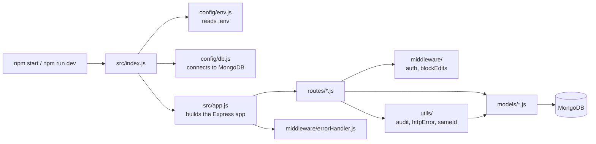
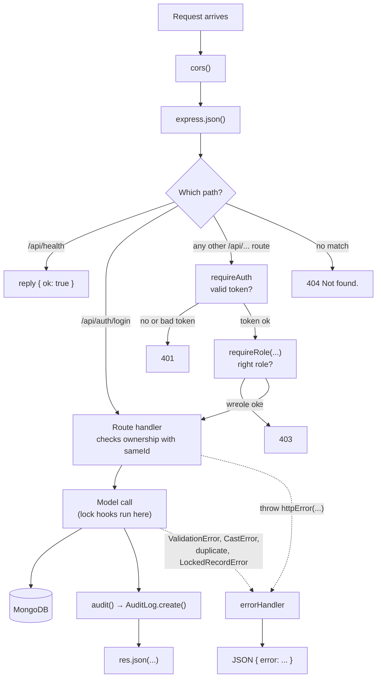
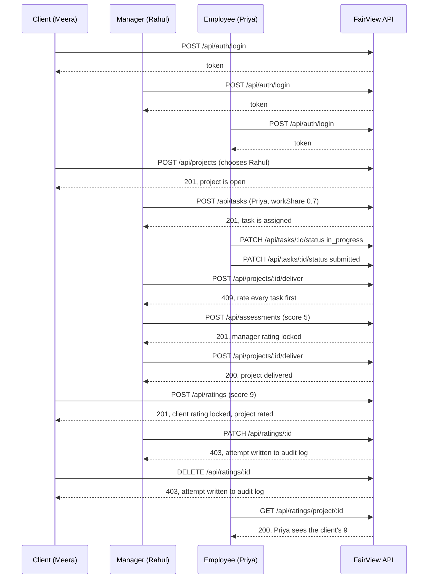

# FairView: How the Code Runs

This file follows the backend code from the moment you type a command to the moment a reply leaves the server: where it starts, what runs in what order, and which function calls which. The reasons behind each choice are in [Decision.md](Decision.md).

Only the backend (`server/`) exists so far. When `client/` or `ml/` is added, or a route, middleware or file changes, update this file in the same commit.

**Reading the code for the first time?** Go in this order: `src/index.js` → `src/app.js` → `src/middleware/auth.js` → `src/routes/ratings.js` → `src/models/lockRecord.js`. These five files explain most of FairView.

All paths below are inside `server/`.

## 1. The big picture



In one line: **a request enters `app.js`, goes to a route file, passes the login and role checks, the route talks to the database through a model, writes an audit entry, and sends back JSON. Any error jumps to `errorHandler.js`.**

## 2. Entry points

The code can start in four ways.

| Command | First file that runs | What happens |
| --- | --- | --- |
| `npm start` | `src/index.js` | Starts the real server |
| `npm run dev` | `src/index.js`, through nodemon | Same, and restarts whenever a file is saved |
| `npm run seed` | `src/scripts/seed.js` | Creates 5 demo accounts, then exits (section 10) |
| `npm test` | Jest → `tests/setup.js` → each `tests/*.test.js` | Runs the tests with no server and no database (section 11) |

`requests.http` is not an entry point. It is a list of requests you send to a server that is already running.

## 3. Starting the server, step by step

1. Node runs `src/index.js`.
2. `require('./config/env')` runs `config/env.js`:
   - `dotenv.config({ quiet: true })` copies the values from `.env` into `process.env`.
   - It works out `port` (default 5000), `jwtExpiresIn` (default `2h`) and `corsOrigin` (default `http://localhost:5173`), and exports them with the `required()` function.
3. `require('./config/db')` only defines `connectDB()`. Nothing runs yet.
4. `require('./app')` runs `src/app.js` from top to bottom (section 4). When it finishes, every route, middleware, model and helper file has been loaded.
5. `start()` runs:
   1. `required('JWT_SECRET')`. If it is empty, this throws `Missing JWT_SECRET in .env`.
   2. `connectDB(required('MONGODB_URI'))` calls `mongoose.connect(uri, { serverSelectionTimeoutMS: 5000 })` and prints `Connected to MongoDB`.
   3. `app.listen(port)` opens the port and prints `FairView API running on http://localhost:5000`.
6. If any step throws, `.catch()` prints `Could not start the server: <reason>` and stops the process with exit code 1.

Two things worth knowing:

- Node loads each file only once and then reuses it. `config/env.js` is required by `index.js`, `app.js`, `middleware/auth.js` and `routes/auth.js`, but dotenv reads `.env` only the first time.
- Models are loaded before the database connects. That is fine: no request can arrive before `app.listen()`, and Mongoose holds any early query until the connection is ready.

## 4. What `app.js` sets up, in order

Express checks these from top to bottom for every request, so the order matters.

| # | Code in `app.js` | What it does |
| --- | --- | --- |
| 1 | `app.use(cors({ origin: corsOrigin }))` | Adds CORS headers and answers the browser's preflight check |
| 2 | `app.use(express.json({ limit: '100kb' }))` | Turns a JSON body into `req.body` (bodies over 100 KB are refused) |
| 3 | `app.get('/api/health', ...)` | Replies `{ "ok": true }`. No login needed |
| 4 | `app.use('/api/auth', require('./routes/auth'))` | Login and "who am I" |
| 5 | `app.use('/api/users', require('./routes/users'))` | Accounts |
| 6 | `app.use('/api/projects', require('./routes/projects'))` | Projects and delivery |
| 7 | `app.use('/api/tasks', require('./routes/tasks'))` | Tasks and status changes |
| 8 | `app.use('/api/assessments', require('./routes/assessments'))` | Manager ratings |
| 9 | `app.use('/api/ratings', require('./routes/ratings'))` | Client ratings |
| 10 | `app.use((req, res) => res.status(404)...)` | Nothing matched: 404 `Not found.` |
| 11 | `app.use(errorHandler)` | Any error from rows 1 to 10 ends up here |

When `app.js` requires a route file, that file requires its own models and helpers. Loading a model file builds its schema. For the three locked models (`ClientRating`, `ManagerAssessment`, `AuditLog`), `schema.plugin(lockRecord, ...)` attaches the lock hooks at this moment, before the server even starts.

## 5. Which file uses which

| File | Uses (requires) | Used by |
| --- | --- | --- |
| `src/index.js` | `config/env`, `config/db`, `app` | Node (`npm start`, `npm run dev`) |
| `src/app.js` | express, cors, `config/env`, `middleware/errorHandler`, all 6 route files | `index.js`, all route tests |
| `config/env.js` | dotenv | `index.js`, `app.js`, `middleware/auth.js`, `routes/auth.js`, `scripts/seed.js` |
| `config/db.js` | mongoose | `index.js` |
| `middleware/auth.js` | jsonwebtoken, `config/env` | all 6 route files |
| `middleware/blockEdits.js` | `utils/audit` | `routes/ratings.js`, `routes/assessments.js` |
| `middleware/errorHandler.js` | nothing | `app.js` |
| `routes/auth.js` | bcryptjs, jsonwebtoken, `User`, `middleware/auth`, `config/env`, `utils/httpError` | `app.js` |
| `routes/users.js` | bcryptjs, `User`, `middleware/auth`, `utils/httpError`, `utils/audit` | `app.js` |
| `routes/projects.js` | `Project`, `Task`, `User`, `ManagerAssessment`, `middleware/auth`, `utils/httpError`, `utils/sameId`, `utils/audit` | `app.js` |
| `routes/tasks.js` | `Task`, `Project`, `User`, `ManagerAssessment`, `middleware/auth`, `utils/httpError`, `utils/sameId`, `utils/audit` | `app.js` |
| `routes/assessments.js` | `ManagerAssessment`, `Task`, `Project`, `middleware/auth`, `middleware/blockEdits`, `utils/httpError`, `utils/sameId`, `utils/audit` | `app.js` |
| `routes/ratings.js` | `ClientRating`, `Project`, `Task`, `middleware/auth`, `middleware/blockEdits`, `utils/httpError`, `utils/sameId`, `utils/audit` | `app.js` |
| `utils/audit.js` | `AuditLog` | 5 route files (not `auth.js`), `blockEdits.js` |
| `utils/httpError.js` | nothing | all 6 route files |
| `utils/sameId.js` | nothing | `projects.js`, `tasks.js`, `assessments.js`, `ratings.js` |
| `models/User.js`, `Project.js`, `Task.js` | mongoose | route files, `seed.js` |
| `models/ClientRating.js`, `ManagerAssessment.js`, `AuditLog.js` | mongoose, `models/lockRecord` | route files, `utils/audit.js` |
| `models/lockRecord.js` | nothing | the three locked models, `tests/locks.test.js` |
| `scripts/seed.js` | bcryptjs, mongoose, `config/env`, `User` | Node (`npm run seed`) |

## 6. The path of every request



The details behind each box:

- **`requireAuth`** (`middleware/auth.js`) reads the `Authorization` header, splits `Bearer <token>`, and runs `jwt.verify(token, JWT_SECRET)`. If that works it sets `req.user = { id: payload.sub, role: payload.role }` and calls `next()`. No header gives 401 `Please log in.`. A forged or expired token gives 401 `Your login has expired or is invalid. Please log in again.`
- **Where `requireAuth` sits:** `users.js`, `projects.js`, `tasks.js`, `assessments.js` and `ratings.js` start with `router.use(requireAuth)`, so every request into them needs a token, even one for a path that doesn't exist (without a token it gets 401, not 404). In `auth.js`, only `/me` uses `requireAuth`. `/login` is open.
- **`requireRole('manager')`** is a function that returns a checker. If `req.user.role` is not in the list, it replies 403 `You do not have permission to do this.` Some routes have no role check and decide inside the handler instead (`GET /api/users`, `GET /api/projects`, `GET /api/ratings/project/:projectId`, and the blocked edit routes).
- **Handlers** are `async`. When one throws `httpError(...)`, or a model call fails, Express 5 catches it and jumps straight to `errorHandler`. That is why there is no `try/catch` in the routes.
- **`req.body`** is `undefined` in Express 5 when no JSON body is sent, which is why handlers start with `req.body || {}`.

## 7. Route by route: which function calls which

Read each block from top to bottom. The left side is what runs; the right side is the reply if that step fails.

### `GET /api/health`
```
app.js handler                                   200 { ok: true }
```

### `POST /api/auth/login`: log in (no token needed)
```
routes/auth.js
→ email and password present?                    400 Email and password are required.
→ User.findOne({ email }).select('+passwordHash')
→ bcrypt.compare(password, user.passwordHash)    401 Wrong email or password.
→ jwt.sign({ sub: user._id, role }, JWT_SECRET, { expiresIn: jwtExpiresIn })
→ 200 { token, user: { id, name, role } }
```
Login is not written to the audit log.

### `GET /api/auth/me`: who am I?
```
requireAuth
→ User.findById(req.user.id)                     404 User not found.
→ 200 { id, name, email, role }
```

### `POST /api/users`: HR creates an account
```
requireAuth → requireRole('hr')
→ password at least 8 characters?                400
→ bcrypt.hash(password, 10)
→ User.create({ name, email, passwordHash, role })
                                                 400 missing name or bad role (ValidationError)
                                                 409 email already used (code 11000)
→ audit({ action: 'user.create' })
→ 201 { id, name, email, role }
```

### `GET /api/users?role=manager`: list people
```
requireAuth
→ User.find(filter, { name: 1, role: 1 })        names and roles only, no emails
→ 200 [ ... ]
```

### `POST /api/projects`: client creates a project
```
requireAuth → requireRole('client')
→ User.findById(managerId)                       400 Please choose a valid manager.
→ Project.create({ title, description, client: req.user.id, manager })
                                                 400 missing title (ValidationError)
→ audit({ action: 'project.create' })
→ 201 project (status 'open')
```

### `GET /api/projects`: my projects
```
requireAuth
→ filter by role:
    client   → { client: me }
    manager  → { manager: me }
    employee → Task.distinct('project', { employee: me }), then { _id: { $in: those } }
    hr       → {} (everything)
→ Project.find(filter).sort({ createdAt: -1 })
→ 200 [ ... ]
```

### `POST /api/projects/:id/deliver`: manager hands the project over
```
requireAuth → requireRole('manager')
→ Project.findById(id)                           404 Project not found.
→ sameId(project.manager, req.user.id)           403 This is not your project.
→ project.status === 'open'?                     409 already delivered
→ Task.find({ project })                         409 no tasks yet / not all submitted
→ ManagerAssessment.countDocuments({ project })  409 Rate every task before delivering the project.
→ project.status = 'delivered'; project.save()
→ audit({ action: 'project.deliver' })
→ 200 project
```
This is where the blind-rating rule is enforced (Decision D-17).

### `POST /api/tasks`: manager creates a task
```
requireAuth → requireRole('manager')
→ Project.findById(projectId)                    404 Project not found.
→ sameId(project.manager, req.user.id)           403 This is not your project.
→ project.status === 'open'?                     409 closed for new tasks
→ User.findById(employeeId), role 'employee'?    400 Please choose a valid employee.
→ Task.find({ project }), add up workShare
→ used + workShare <= 1 + EPSILON?               400 Only X% of this project is left to assign.
→ Task.create({ project, manager, employee, title, workShare })
→ audit({ action: 'task.create' })
→ 201 task (status 'assigned')
```

### `GET /api/tasks?projectId=...`: my tasks
```
requireAuth → requireRole('employee', 'manager', 'hr')
→ filter: employee → { employee: me } · manager → { manager: me } · hr → {}
→ add { project: projectId } if given
→ Task.find(filter).sort({ createdAt: -1 })
→ 200 [ ... ]
```

### `PATCH /api/tasks/:id/status`: move a task forward or send it back
```
requireAuth → requireRole('employee', 'manager')
→ Task.findById(id)                              404 Task not found.
→ Project.findById(task.project), still 'open'?  409 This project is closed.
→ if employee:
    sameId(task.employee, me)                    403 This is not your task.
    next step only (assigned → in_progress → submitted)
                                                 409 cannot move to that status
    if 'submitted': submission text present?     400 Describe or link the work...
  if manager:
    sameId(task.manager, me)                     403 This is not your task.
    only submitted → in_progress                 409 can only send back for rework
    ManagerAssessment.exists({ task })           409 already rated, can't send back
→ task.status = status; task.save()
→ audit({ action: 'task.in_progress' or 'task.submitted' })
→ 200 task
```

### `POST /api/assessments`: manager rates a task
```
requireAuth → requireRole('manager')
→ Task.findById(taskId)                          404 Task not found.
→ sameId(task.manager, req.user.id)              403 This is not your task.
→ task.status === 'submitted'?                   409 rate only after it is submitted
→ Project.findById(task.project), still 'open'?  409 This project is already delivered.
→ ManagerAssessment.create({ task, project, manager, employee, score, feedback })
                                                 400 score not a whole number 1-10
                                                 409 task already rated (code 11000)
→ audit({ action: 'assessment.create' })
→ 201 assessment (locked from now on)
```

### `GET /api/assessments`: manager ratings
```
requireAuth → requireRole('manager', 'employee', 'hr')
→ filter: manager → { manager: me } · employee → { employee: me } · hr → {}
→ ManagerAssessment.find(filter).sort({ createdAt: -1 })
→ 200 [ ... ]
```

### `POST /api/ratings`: client rates a delivered project
```
requireAuth → requireRole('client')
→ Project.findById(projectId)                    404 Project not found.
→ sameId(project.client, req.user.id)            403 This is not your project.
→ project.status === 'rated'?                    409 already rated
→ project.status === 'delivered'?                409 rate only after delivery
→ ClientRating.create({ project, client, score, review })
                                                 400 score not a whole number 1-10
                                                 409 already rated (code 11000)
→ project.status = 'rated'; project.save()
→ audit({ action: 'rating.create' })
→ 201 rating (locked from now on)
```

### `GET /api/ratings/project/:projectId`: see a project's client rating
```
requireAuth
→ Project.findById(projectId)                    404 Project not found.
→ allowed if any of:
    role 'hr'
    role 'client' and sameId(project.client, me)
    role 'manager' and sameId(project.manager, me)
    role 'employee' and Task.exists({ project, employee: me })
                                                 403 no permission
→ ClientRating.findOne({ project })              404 not rated yet
→ 200 rating
```

### `PUT`, `PATCH` or `DELETE` on `/api/ratings/:id` or `/api/assessments/:id`: always refused
```
requireAuth                                      401 if not logged in (nothing is logged)
→ blockEdits('ClientRating' or 'ManagerAssessment')
    → audit({ action: 'ClientRating.patch', outcome: 'blocked', entityId: id, ... })
→ 403 ... records are locked and cannot be changed or deleted.
```
No role check: every role, HR included, gets the same 403.

## 8. Inside a model call: the lock hooks

`models/lockRecord.js` adds hooks to `ClientRating`, `ManagerAssessment` and `AuditLog`. Mongoose runs a hook just before the matching operation.

**Creating a rating** (what the routes do):
```
ClientRating.create(data)
→ new document, isNew = true
→ pre('validate') refuseEdits: isNew, so it lets it through
→ schema rules: required fields, score 1-10, whole number    ValidationError → 400
→ pre('save') refuseEdits: isNew, so it lets it through
→ insert into MongoDB
→ unique index on project (or task)                           code 11000 → 409
```

**Changing or deleting a rating** (nothing in the routes does this; the hooks are the safety net):
```
ClientRating.updateOne(...)   or deleteOne, findOneAndUpdate, bulkWrite, ...
→ pre-hook throws LockedRecordError (status 403)
→ the operation never reaches MongoDB
→ the error travels up to the route → errorHandler → 403

doc.save() on a record loaded from the database
→ pre('validate') refuseEdits: isNew is false → LockedRecordError → 403
```

`Project` and `Task` have no lock. `project.save()` and `task.save()` update them normally, except that fields marked `immutable` (owners, work share) silently keep their old value.

## 9. How an error travels

```
route handler:  throw httpError(409, 'This project has already been delivered.')
      │
      │  Express 5 catches the rejected promise and skips everything else
      ▼
middleware/errorHandler.js:  errorHandler(err, req, res, next)
      ├─ err.name === 'ValidationError'  → 400, all validation messages joined
      ├─ err.name === 'CastError'        → 400 Invalid <field>.
      ├─ err.code === 11000              → 409 This already exists.
      ├─ err.status is set               → that status and err.message
      └─ anything else                   → console.error(err), 500 Something went wrong on the server.
      ▼
res.status(...).json({ error: '...' })
```

`httpError()` (`utils/httpError.js`) just creates an `Error` with a `status` attached. `LockedRecordError` has `status = 403` built in, so it takes the same path.

## 10. The full story in one picture

This is the same flow as the 14 steps in `requests.http`.



## 11. `npm run seed`

`seed.js` runs on its own. It does not load `index.js` or `app.js`.

```
src/scripts/seed.js
→ require config/env.js (dotenv reads .env)
→ require models/User.js
→ seed():
    mongoose.connect(MONGODB_URI)        (no 5-second limit here, see Decision.md Known gaps)
    bcrypt.hash('password123', 10)       once, shared by all 5 users
    for each demo user:
        User.exists({ email })  → yes: print "exists"   no: User.create(...), print "created"
    mongoose.disconnect()
→ on any error: print the message, exit with code 1
```

## 12. `npm test`

1. Jest reads the `"jest"` section of `package.json`: Node environment, and `tests/setup.js` as a setup file.
2. Each test file gets its own fresh copy of every module. Before it runs, `tests/setup.js` sets `JWT_SECRET = 'test-secret-only-for-tests'` and turns off Mongoose's command buffering, so any accidental database call fails at once instead of waiting.
3. Jest moves every `jest.mock(...)` line to the top of the file before anything is required. So when the test requires `src/app.js`, and `app.js` requires the route files, the routes receive the fake models.
4. `tests/helpers.js` gives fixed fake ids, `tokenFor(id, role)` (signs a real JWT with the test secret), and `fakeProject()` (a plain object with a fake `save()`).
5. `request(app).post(...)` from Supertest runs the full request path from section 6 in memory. No port is opened, `index.js` never runs, and no database is touched.

| Test file | What it checks | What is faked |
| --- | --- | --- |
| `auth.test.js` | Login, forged and expired tokens, only HR can create accounts | `User`, `AuditLog` |
| `ratings.test.js` | Nobody can edit or delete a client rating; who can give and see one | `Project`, `Task`, `ClientRating`, `AuditLog` |
| `workflow.test.js` | Work share cap; manager must rate before delivery | `Project`, `Task`, `User`, `ManagerAssessment`, `AuditLog` |
| `locks.test.js` | Every update and delete is refused on the 3 locked models; score and work share rules | Nothing. Real models, and the hooks throw before any database call |

## 13. Not built yet

- **`client/`** (React): will log in through `POST /api/auth/login`, keep the token, and send it as `Authorization: Bearer <token>` on every other call.
- **`ml/`** (Python, FastAPI): the backend will send manager and client rating pairs to it and get gap scores back. It will not be open to the public.

Add both to this file as soon as they exist.
